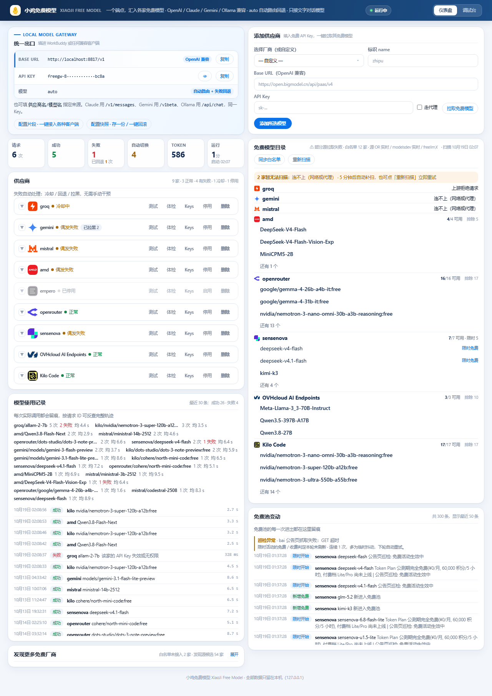

# 小鸡免费模型 XiaoJi Free Model

**本地免费大模型聚合网关** —— 把各家平台的免费大模型 API 聚合成 **一个 OpenAI 兼容端点 + 一个统一 Key**，
支持 `auto` 自动路由与失败回退。

零依赖 · 单文件（`server.mjs`）· 只监听 `127.0.0.1` · 仅需 **Node.js ≥ 18**

[](https://github.com/smallji666/xiaoji-free-model-gateway/actions/workflows/tests.yml)
[](LICENSE)
[](package.json)



> 设计取向：**轻量、简洁、够用**。宁可少一个面板，不要多一个没人用的开关。

---

## 它是干什么的

你手里大概有好几家平台的免费额度（Groq、Gemini、Mistral、OpenRouter……），但它们的接口地址、Key、
模型名各不相同，客户端里配一堆很烦，某家限流了还得手动换。

这个网关做三件事：

1. **聚合**：一个地址 `http://localhost:8787/v1` + 一个 Key，就能用上所有免费模型。
2. **路由**：模型名填 `auto`，自动挑当前最快、最健康的那家；一家失败自动换下一家。
3. **防扣费**：只放行**确认免费**的模型，撞到收费特征当场拉黑 —— 不会因为手滑刷爆账单。

服务只监听本机，不对外网开放，没有遥测、没有云端。

## 30 秒跑起来

**前提**：装好 [Node.js](https://nodejs.org/zh-cn) 18 或更高版本（`node -v` 能打印版本号即可）。

### Windows

1. 双击 **`小鸡开关.bat`** —— 网关在后台隐藏启动，几秒后窗口自动关闭
2. 浏览器打开 <http://localhost:8787>

### macOS / Linux

```bash
# 前台运行（Ctrl+C 停止）
node server.mjs

# 或后台运行
./scripts/start.sh start      # start | stop | restart | status | logs | open
```

### Docker

```bash
docker build -t xiaoji-free-model .
docker run -d --name xiaoji \
  -p 127.0.0.1:8787:8787 \
  -v xiaoji-data:/app \
  xiaoji-free-model
```

> 配置与运行状态都存在 `/app` 卷里，重建容器不会丢。端口只映射到宿主机 `127.0.0.1`。

### 接进你的客户端

打开仪表盘，右上角「统一出口」卡片里有现成的 Base URL 和 Key。填进任意 OpenAI 兼容客户端：

| 配置项 | 填什么 |
|---|---|
| Base URL | `http://localhost:8787/v1` |
| API Key | 仪表盘「统一出口」里的 `freegw-...`（首启自动生成） |
| 模型 | `auto`（或 `厂商/模型名`，见仪表盘「免费模型目录」） |

仪表盘上还有「配置片段」，一键给出 WorkBuddy / curl / Python / Node / Claude Code / Gemini / Ollama 七套写法，复制即用。

## 添加第一个供应商

1. 仪表盘右上「添加供应商」→ 选一家（如 Groq）→ 粘贴自己的 API Key
2. 点「拉取免费模型」—— 它会实时调该家 `/v1/models`，帮你过滤出**真正免费、可用于聊天**的模型
3. 勾选要用的模型，保存即生效（**不用重启**）

不想配任何 Key 也能先试：池子里有几家**免 Key 端点**（免 Key 意味着我们手上没有账号，也就没有扣费通道）。

## 为什么是它

|  | 本项目 | LiteLLM / one-api 之类 |
|---|---|---|
| **依赖** | **零依赖**，`node server.mjs` 就跑 | Python / Go + 数据库 + 部署流程 |
| **免费池** | **自动判定 + 每 6 小时实测同步**，不用手工维护名单 | 手工配 Key、手工填模型名 |
| **防扣费** | 四层判定 + 全池体检 + 撞到收费特征当场拉黑 | 靠人记得改 |
| **协议** | OpenAI / Anthropic / Gemini / Ollama **原生互转** | 多为 OpenAI 兼容一种 |
| **隐私** | 只监听 `127.0.0.1`，无遥测、无云端 | —— |

## 亮点

- **免费判定四层闸门** —— 上游价格元数据 → 每 6 小时同步的多源白名单 → 开放视野厂商 → 兜底规则。
  **宁可漏判，不可错判**（错判直接等于扣费）。手动填的模型一律先进隔离区，确认免费才放行。
  → [细节](docs/free-detection.md)
- **路由与容错** —— **对冲请求**（领跑 3 秒不吐响应头就并行开下一家，最坏情况 12s → 3s）、
  分层冷却、模型级质量统计、按实测首字节与吞吐排序、粘性会话。
  **路由组**：一个名字 = 一组候选（`local-only` / `vision` / 省钱组），组名当模型名用，组内照样故障转移。
  → [细节](docs/routing.md)
- **失败不会越拖越慢** —— 一个真坏的模型不会每 90 秒被选中一次、白等一个往返：连续失败按
  90→180→360→720 秒退避（过载是 60→…→600），成功一次立刻清零。首字节超时也按模型**自己的**
  常态收紧到 6 秒级 —— 但只在链上还有别的候选时才敢提前放弃，最后一个候选仍等满 15 秒。
  额度冷却到**厂商自己的**重置时间（`openrouter` 是 UTC 零点）；代理没开只冷却 5 秒，
  因为病因在本机、打开代理就该立刻能用。
- **请求太大不会直接失败** —— 免费池窗口普遍只有 8k~32k，而 agent 客户端会把整段历史原样发过来。
  这时网关**裁一段历史重发**（留 `system` + 最近几轮，`tools` 定义一律不裁），而不是回一个
  病因错误的"模型不在池里"；裁过的响应带 `x-xiaoji-compacted` 说明丢了多少条。
  容量不足的候选只**降档**不排除，池子小时照样能拿到答案。
- **省着用额度** —— 一模一样的非流式请求并发时只打一次上游（`coalesce`，响应带
  `x-xiaoji-coalesced`）；全池同时限流且上游说"再等几秒"时，等这一小会儿重试一次
  （`retryOnRateLimit`），而不是直接甩 502。两个都能在 `config.json` 里一键关掉，保存即生效。
- **五协议原生接入** —— `/v1/chat/completions`、`/v1/responses`（Codex CLI 用的 Responses API）、
  `/v1/messages`（Anthropic）、`/v1beta/models/<model>:generateContent`（Gemini）、`/api/chat`（Ollama）。
  同一个网关 Key，自动与 OpenAI 格式互转，**共用同一条路由链**。
- **可观测性** —— 每个响应（含错误与 401）都带 `x-request-id`；候选级 `usage_log` 与请求级 `metrics`
  刻意分开；`/healthz`、`/metrics`（Prometheus 文本）、`/api/why`（解释一个模型为什么被判免费）。
  上游的 `x-ratelimit-*` 配额响应头会采下来，仪表盘直接显示「今天还剩 N 次」——不必等撞 429 才知道。
  → [接口](docs/api.md)
- **改完不用重启** —— `config.json` 支持热重载：手工改 proxy / 换 Key / 加别名保存即生效
  （端口除外，会明确提示"重启后生效"）。运行时状态（冷却、拉黑、实测学习）不会被文件里的旧快照覆盖。
- **500+ 项自动化测试** —— 离线组零 Key、零网络，可在 CI 跑。→ [测试台](docs/testing.md)

## 文档

| 主题 | 文件 |
|---|---|
| 安装、启停、使用流程 | [docs/usage.md](docs/usage.md) |
| 免费判定与厂商名单是怎么来的 | [docs/free-detection.md](docs/free-detection.md) |
| 路由、对冲、冷却、容错规则 | [docs/routing.md](docs/routing.md) |
| 接口与文件一览 | [docs/api.md](docs/api.md) |
| 测试台（怎么跑、怎么加） | [docs/testing.md](docs/testing.md) |
| 打成 WorkBuddy 技能包并上架 | [docs/publishing.md](docs/publishing.md) |
| 安全说明与已知局限 | [docs/security.md](docs/security.md) |
| 变更记录 / 路线图 / 贡献指南 / 安全策略 | [CHANGELOG.md](CHANGELOG.md) · [ROADMAP.md](ROADMAP.md) · [CONTRIBUTING.md](CONTRIBUTING.md) · [SECURITY.md](SECURITY.md) |

## 常见问题

**端口 8787 被占用？**
`config.json` 里改 `"port": 8790`，重启即可（端口不支持热重载）。Windows 上也可以改 `小鸡开关.bat` 顶部的 `PORT`。

**海外厂商连不上（`ECONNREFUSED` / 超时）？**
这类厂商需要代理。仪表盘「代理」里填你自己的代理地址，例如 Clash 常见的 `http://127.0.0.1:7890`；
或者直接在 `config.json` 里写 `"proxy": "http://127.0.0.1:7890"`，保存即生效。

**改了 `config.json` 没反应？**
除 `port` 外都会热重载。若确实没生效，先确认网关进程在跑：`curl http://localhost:8787/healthz`。

**Key 存在哪里？会不会被上传？**
只存在本地 `config.json` 里，明文（见下方「安全」）。本项目没有任何上报逻辑。

**能不能给局域网/公网用？**
可以，但要先把 `config.json` 的 `auth.mode` 改成 `token` 并配一个 16 位以上的随机串，
否则任何能访问端口的人都能白嫖你的 Key。详见 [docs/security.md](docs/security.md)。

## 安全

- **本仓库不含任何 API Key**。`config.json`（含明文 Key）、运行日志、用量记录全部在 `.gitignore` 里；
  `npm run secrets` / CI 每次都会跑 `scripts/check-secrets.cjs` 拦一道。
- 服务**硬绑 `127.0.0.1`**，不对外网暴露；`/api/*` 不下发 CORS 头 + 写操作强制 `content-type: application/json`（防本地 CSRF / 恶意网页偷 Key）。
- 管理接口回显的 Key 一律**掩码**；日志不记录明文网关 Key。
- `config.json` 里各家 Key 是**明文**存储 —— 这是刻意的：密钥文件与密文在同一台机器上，本地加密只增加"密钥丢了模型全废"的风险，挡不住能读到文件的人。**真正的对策是别把项目目录同步到网盘或提交仓库**（仓库自带 `.gitignore` 与 `scripts/check-secrets.cjs` 双重保险）。
- 详见 [docs/security.md](docs/security.md)；报告漏洞请见 [SECURITY.md](SECURITY.md)（先读里面的威胁模型，能省掉一半无效报告）。

## 许可证

[MIT](LICENSE)
